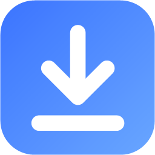

# PKGo para PS4

Instale e gerencie pacotes de PS4 pela rede local com o **GoldHEN**, a partir do Windows ou do Linux.
Nenhum app instalador precisa estar aberto no console.

[English](README.md)

## Recursos

- **Biblioteca no PC**: adicione quantas pastas quiser (com subpastas), ou arraste pastas e PKGs para a janela, e veja cada PKG com capa, título, versão e tipo (jogo, atualização, DLC ou app/homebrew).
- **Instalação em um clique**: o PKGo serve o arquivo pela rede e o PS4 baixa em segundo plano, com progresso, velocidade e tempo restante. Os pacotes entram numa fila e instalam um depois do outro.
- **Marque vários pacotes** e instale de uma vez (jogos primeiro, depois atualizações e DLCs), ou marque todos os que o filtro mostra.
- **Excluir do PC**: os pacotes marcados vão para a Lixeira; a pasta que é só daquele jogo vai junto (nunca uma pasta da biblioteca ou uma pasta sua, como Downloads).
- **Checagem de região**: cada pacote mostra sua região (EUA, Europa, Japão, Ásia). Atualizações e DLCs feitas para a versão de outra região de um jogo instalado são sinalizadas e ficam de fora das instalações em lote.
- **Instalar todas as atualizações**: um botão coloca na fila cada atualização mais nova que a do PS4 e as DLCs que ele ainda não tem.
- **Acompanha o PS4 em tempo real**: falhas, downloads cancelados ou jogos excluídos no console aparecem na hora. Downloads que falham são tentados de novo, e os cancelados ou com falha saem da lista de downloads do PS4, sem deixar notificação de erro.
- **Aba do console**: lista os jogos e apps instalados no PS4, com versão, atualização, quantidade de DLCs e espaço ocupado.
- **Excluir do PS4**: remova um jogo, ou só a atualização, pelo desinstalador do sistema. Os dados salvos ficam.
- **Encontra o seu PS4** na rede sozinho, ou você digita o IP.
- **Teclado e controle**: as setas ou o direcional navegam como no PS4; ✕ escolhe, ○ volta, L1/R1 trocam de aba.
- **Atualiza sozinho**: o instalador e o AppImage/.deb do Linux baixam versões novas em segundo plano e instalam ao reiniciar (nunca durante um envio ao PS4). A versão portátil avisa quando sai uma versão nova.
- **Diagnóstico**: um clique copia versões, conexões e eventos recentes, para anexar ao relatar um problema.
- **Português (Brasil), English e Español**, seguindo o idioma do sistema por padrão.

## Requisitos

- PS4 com o **GoldHEN** carregado, com estas opções ativadas em _Configurações > GoldHEN > Server Settings_:
  - **servidor FTP** (porta 2121), para ler o que está instalado;
  - **servidor BinLoader** (porta 9090), para instalar e excluir;
  - opcionalmente o **servidor Klog** (porta 3232), para acompanhar os downloads em tempo real. O PS4 entrega o log a um programa por vez.
- PC e PS4 na mesma rede local.

## Instalação

Baixe a versão mais recente:

| Sistema | Arquivo                                                            |
| ------- | ------------------------------------------------------------------ |
| Windows | `PKGo-Setup-x.y.z.exe` (instalador) ou `-Portable-` (sem instalar) |
| Linux   | `pkgo-x.y.z-x86_64.AppImage` ou `pkgo-x.y.z-amd64.deb`             |

No Linux:

- **`.deb`** (Debian, Ubuntu, Mint…): `sudo apt install ./pkgo-x.y.z-amd64.deb` configura tudo, inclusive o atalho no menu.
- **AppImage** (a maioria das distribuições): dê `chmod +x` antes. Como todo AppImage, ele precisa do FUSE 2, que o Ubuntu 22.04 e mais novos não trazem mais: instale com `sudo apt install libfuse2t64` (`libfuse2` no 22.04), ou abra o AppImage com `--appimage-extract-and-run`. No Ubuntu 24.04 ou mais novo, que restringe a sandbox do Chromium em AppImages, acrescente `--no-sandbox` se ainda não abrir.

Na primeira vez, o PKGo procura o seu PS4. Se o firewall perguntar, permita o acesso em **redes privadas**: o console baixa os pacotes do seu PC.

## Como funciona

- **Instalar**: o PKGo envia um pequeno payload ao BinLoader do GoldHEN. Ele registra o download no serviço de downloads do próprio PS4, apontando para o servidor de arquivos do PKGo, e o console baixa o PKG direto do seu PC.
- **Excluir e limpar downloads**: outro payload chama o desinstalador do sistema, ou tira um download parado da lista de downloads do PS4, e devolve o resultado.
- **Tempo real**: o PKGo lê o log do kernel pelo GoldHEN para saber o que o PS4 faz com cada download.
- **Lista do console**: lida pelo servidor FTP do GoldHEN.

Os payloads ficam em [`payloads/`](payloads/README.md), com o código-fonte e o script de build.

## Desenvolvimento

Requer Node.js 22.12 ou mais novo.

```sh
npm install
npm run dev          # roda com recarga automática
npm test             # testes (vitest)
npm run test:e2e     # testes da interface no app compilado (Playwright, sem PS4)
npm run lint         # ESLint
npm run typecheck    # TypeScript
npm run dist:win     # instalador e versão portátil para Windows (dist/)
npm run dist:linux   # AppImage e .deb (dist/, rodar no Linux)
npm run payloads     # recompila os payloads (Linux/WSL, veja payloads/README.md)
```

A organização do código e o guia para contribuir estão no [README em inglês](README.md) e no [CONTRIBUTING.md](CONTRIBUTING.md).

## Créditos

- Payload de instalação: [DirectPackageInstaller](https://github.com/marcussacana/DirectPackageInstaller), de marcussacana (GPL-3.0).
- Nomes das funções do desinstalador conforme o [Itemzflow](https://github.com/LightningMods/Itemzflow) (GPL-3.0).
- [GoldHEN](https://github.com/GoldHEN/GoldHEN), de SiSTR0 e colaboradores.

## Licença

[GPL-3.0](LICENSE). O PKGo não tem vínculo com a Sony Interactive Entertainment. Use apenas com conteúdo ao qual você tem direito.
